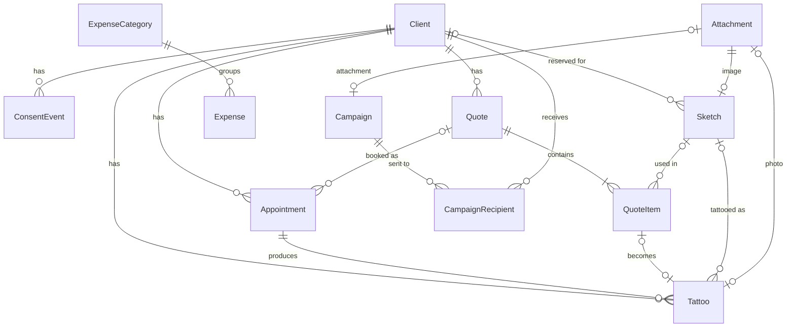

# Data Model

Corrected from section 12 of `AYA_INK_new.docx` (which calls itself a "suggested
engineering baseline"). The changes are listed at the bottom along with the reason for each.

## Conventions (all tables)

| Field | Rule |
|---|---|
| `id` | UUID, **generated on the device**, so retries, sync and backup restore never create duplicates |
| `createdAt`, `updatedAt` | `timestamptz` (UTC) |
| `deletedAt` | Soft delete; nothing is hard-deleted |
| `version` | Integer for optimistic locking (concurrent iPhone/iPad edits) |
| Money | Integer **agorot** (`35000` = 350 ₪) |
| Time | Stored in UTC; "has passed" and month bucketing evaluated in `Asia/Jerusalem` |

## Diagram



## Entities — MVP

### Settings (single row)
`minimumPriceAgorot` (35000), `minimumMinutes` (30), `hourlyRateAgorot` (33000 → 5.5 ₪/min),
`designHourlyRateAgorot` (20000, suggested value), `needleOpeningCostAgorot` (7000, internal business figure only),
`extraNeedleCostAgorot` (5000, tentative), `estimateTables` (JSON — the size base minutes and
the detail/shading/placement multipliers below, all editable), `calibrationPoints` (JSON: arm 180, back 180,
cherry 80, figure with book 120, rose 60, deer 120 minutes), `autoLockSeconds`, `timezone`
(`Asia/Jerusalem`), `testEmail` (phase 2).

### Client
`id, name (required), phone?, email?, instagram?, notes?,
marketingConsent (granted|revoked|none — a cached copy of the latest ConsentEvent), consentUpdatedAt?,
unsubscribeToken`.
Search: name, phone, Instagram. Computed when read: tattoo count, money summary.
No discount field on the client: discounts exist only on quotes.

### ConsentEvent
`id, clientId, action (granted|revoked), source (app|unsubscribe_link), at`.
The audit trail for marketing consent; `Client.marketingConsent` mirrors the latest event.

### Quote — one visit
`id, clientId (required to save; a quote that is only copied isn't saved), title, notes?,
discountType (none|percent|amount), discountValue, extraNeedles (count),
priceOverrideAgorot?, computedPriceAgorot, finalPriceAgorot, estimatedMinutesTotal`.
Saving a quote never creates an appointment. Quotes **don't expire**. A quote can be
booked as **several appointments** (sessions of a large piece).

### QuoteItem — one tattoo within the visit
`id, quoteId, position, description, size, detailLevel, shading, bodyPlacement,
designSource (artist_sketch|client_reference|custom_design), sketchId?, designHours?,
estimatedMinutes (calculated), estimatedMinutesOverride?`.

**Pricing (per visit):**
```
visitMinutes = Σ items (override ?? estimated)
base         = 350 ₪ + max(0, visitMinutes − 30) × 5.5 ₪     ← minimum/needle fee once per visit
design       = Σ custom_design items: designHours × designHourlyRate
extras       = extraNeedles × extraNeedleCost                   ← only if added under "more options"
subtotal     = base + design + extras
final        = priceOverride ?? applyDiscount(subtotal)   ← discount applies to the whole subtotal, design fee included
```
Placement affects time only, never price directly. Artist sketch or client reference = no design fee.

**Time estimate (per item):**
```
estimatedMinutes = roundUpTo5( max(15, sizeBase × detail × shading × placement) )
```

| Size | Base min | | Detail | × | | Shading | × | | Placement | × |
|---|---|---|---|---|---|---|---|---|---|---|
| XS (≤ 3 cm) | 20 | | simple | 0.8 | | none (line only) | 1.0 | | easy: forearm, outer arm, thigh, calf | 1.0 |
| S (3–7 cm) | 40 | | medium | 1.0 | | light | 1.2 | | medium: back, shoulder, chest, wrist, ankle | 1.1 |
| M (7–12 cm) | 75 | | high | 1.35 | | full | 1.45 | | hard: ribs, neck, hands, feet, spine, sternum | 1.25 |
| L (12–20 cm) | 120 | | | | | | | | | |
| XL (20 cm+ / half sleeve, back piece) | 180 | | | | | | | | | |

- Design source doesn't change tattoo time; custom design time is the separate `designHours`.
- All numbers live in `Settings.estimateTables` and can be edited. The estimate is a starting point and
  Aya can always override it (`estimatedMinutesOverride`).
- Checked against the calibration points: rose M × simple = 60 ✓, deer/figure with book L = 120 ✓,
  arm XL = 180 ✓, cherry M ≈ 75 (calibration 80) ✓, back XL × 1.1 ≈ 200 (calibration 180, close).
  The calculator shows the nearest calibration point as a hint ("similar: rose ≈ 60 min").
- Phase 2 can retune the tables from recorded `actualMinutes`.

### Appointment
`id, clientId, quoteId?, startAt, durationMinutes, agreedPriceAgorot, description,
status (scheduled|cancelled), notes?`.
"Completed" is **computed**: `status = scheduled AND startAt + duration < now`. It is never stored.
Choosing a quote pre-fills the description, price and duration (copied, then editable).

### Tattoo
`id, clientId, appointmentId?, quoteItemId?, sketchId?, description, bodyPlacement?,
actualMinutes?, photoAttachmentId?, completedAt? (only for tattoos with no appointment)`.
- **Created automatically** when an appointment is saved: one per quote item, or one if there's no quote.
  Shown as done once the appointment has passed; hidden while the appointment is cancelled or in the future.
- Can also be created by hand with no appointment (e.g. work done before the app existed).
- **Gallery** = completed tattoos with a photo. It's a view, not a table, so each photo appears exactly once.
- `actualMinutes` will feed phase 2 time-estimate learning.

### Sketch
`id, title, imageAttachmentId, status (available|reserved|done), reservedForClientId?,
tags?, notes?`. No price field. One-time exclusive use by default. Becomes `done`
when a completed Tattoo references it. **`reservedForClientId` is required when
`status = reserved`** (enforced by a DB check constraint). Requests for variations are not recorded.

### Expense
`id, date (defaults to today), title, amountAgorot, categoryId, notes?`.

### ExpenseCategory
`id, name, sortOrder, isSystem`. Starts with: equipment & materials, marketing &
advertising, studio & operations, other. The doc calls these "initial" categories,
so Aya can add more.

### Attachment
`id, kind (tattoo_photo|sketch|newsletter), storageKey (R2), mimeType, sizeBytes,
width?, height?`.

### Computed (never stored)
- Income for a month = Σ `agreedPrice` of completed appointments whose `startAt` falls in that month (Israel time).
- Balance = income − Σ expenses for the month. Labelled as a computed balance, **not** accounting profit.

## Entities — Phase 2 (email marketing)

### Campaign
`id, subject, body, attachmentId, audienceFilter (JSON), status
(draft|scheduled|sending|sent|cancelled|failed), scheduledAt?, sentAt?, testSentAt?`.

### CampaignRecipient
`campaignId, clientId` (**unique pair**, blocks double sends), `consentCheckedAt,
deliveryStatus (queued|sent|failed|skipped_no_consent), providerMessageId?, error?`.

## Changes from the doc's model

| # | Change | Why |
|---|---|---|
| 1 | Split `Quote` → `Quote` + `QuoteItem` | Several tattoos per visit; minimum/needle fee charged once per visit (doc §4.1–4.2, confirmed) |
| 2 | Added `Settings` | Doc says the rates can be changed in settings and are "suggested values" |
| 3 | Appointment status = `scheduled|cancelled`; "completed" is computed | Income comes only from appointments that have passed and weren't cancelled (doc §8.1); storing "completed" would go stale |
| 4 | Tattoo created automatically per appointment/item; gallery is a view | Confirmed: tattoo records are created automatically; one photo shows up exactly once (doc §6, §13) |
| 5 | `sketchId` on QuoteItem and Tattoo; `reservedForClientId` on Sketch | Doc links sketches to quotes and clients, and the "done" status must follow from a real tattoo |
| 6 | `ConsentEvent` history + `unsubscribeToken` | Doc requires consent to be explicit, revocable and tracked, plus unsubscribe in every email (§3, §9) |
| 7 | UUIDs from the device, `updatedAt`, `deletedAt`, `version` everywhere | Doc acceptance test: switching devices or restoring a backup must create no duplicates (§13); iPhone/iPad sync |
| 8 | Money in integer agorot | Avoids rounding errors (5.5 ₪/min) |
| 9 | `ExpenseCategory` table | Doc calls the categories "initial" |
| 10 | `actualMinutes` on Tattoo | Confirmed: record actual duration for later calibration |
| 11 | `CampaignRecipient` unique `(campaignId, clientId)` + delivery status | Doc requires preventing duplicates and tracking failures (§9) |

## Decisions (answered 2026-11-15)

| # | Question | Decision |
|---|---|---|
| 1 | Can one quote be booked as several appointments? | **Yes**: `Quote 1 → many Appointment` |
| 2 | Does the discount also apply to the design fee? | **Yes**: discount applies to the whole subtotal |
| 3 | Time-estimate formula | **Tech lead's call**: size base × detail × shading × placement, editable tables (see Quote section) |
| 4 | Do quotes expire? | **No** |
| 5 | Record client requests for sketch variations? | **No** |
| 6 | Must a reserved sketch be linked to a client? | **Yes**: required when `status = reserved` |
